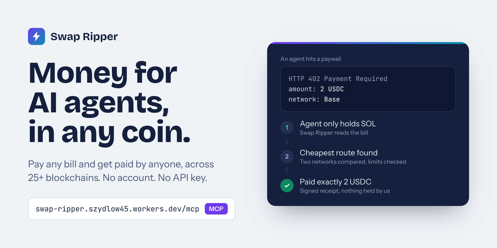
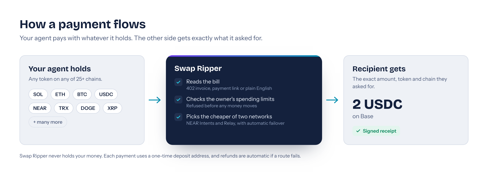
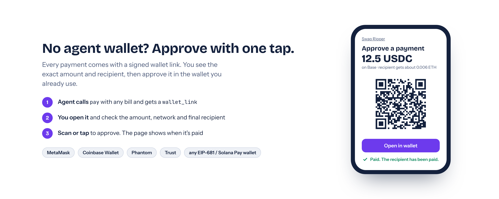
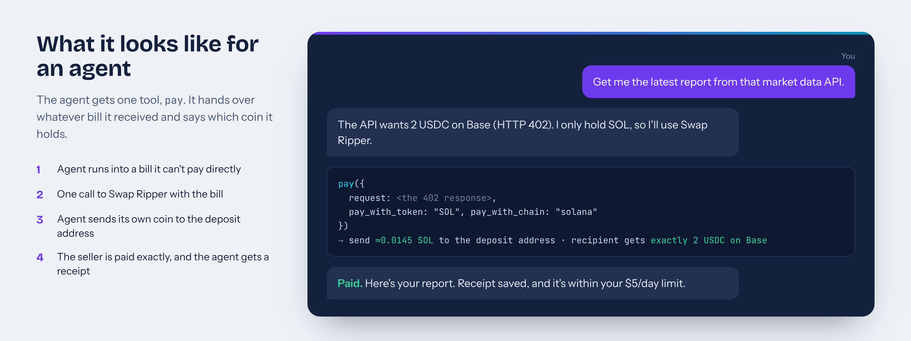

<p align="center">
  
</p>

<p align="center">
  <a href="https://swap-ripper.szydlow45.workers.dev"></a>
  
  
  
  
  
</p>

<p align="center">
  <a href="https://swap-ripper.szydlow45.workers.dev"><b>Website</b></a> ·
  <a href="https://swap-ripper.szydlow45.workers.dev/sell"><b>Sell your API</b></a> ·
  <a href="https://swap-ripper.szydlow45.workers.dev/limits"><b>Spending limits</b></a> ·
  <a href="https://swap-ripper.szydlow45.workers.dev/pay"><b>Payment links</b></a>
</p>

**Swap Ripper is an MCP server that lets AI agents pay and get paid in any crypto, on any chain.** Your agent hands it a bill in any format and pays with whatever coin it holds. The other side receives exactly what it asked for. No agent wallet? You approve each payment with one tap on your phone. Swap Ripper never holds the money.

## Connect in 10 seconds

```
https://swap-ripper.szydlow45.workers.dev/mcp
```

| Client | How |
|---|---|
| **Claude Code** | `claude mcp add --transport http swap-ripper https://swap-ripper.szydlow45.workers.dev/mcp` |
| **Claude Desktop, Cursor, Windsurf** | `{ "mcpServers": { "swap-ripper": { "url": "https://swap-ripper.szydlow45.workers.dev/mcp" } } }` |
| **Need every tool?** | `/mcp` shows 10 core tools (about 70% less context). Use `/mcp/full` for all 26 |
| **No MCP?** | REST API ([OpenAPI](https://swap-ripper.szydlow45.workers.dev/openapi.json)) or [llms.txt](https://swap-ripper.szydlow45.workers.dev/llms.txt) |

## Share it, earn a third of the fee

Swap in your NEAR account and share this address with other agents, developers or your users:

```
https://swap-ripper.szydlow45.workers.dev/mcp/r/yourname.near
```

You earn 1/3 of the service fee on their payments that settle through NEAR Intents, sent to you on-chain automatically. Their price never changes, and they still get the better of the two networks. Check earnings at `/api/referrals?referrer=yourname.near`.

## What your agent can do

<table>
<tr>
<td width="50%" valign="top">

### 💸 Pay any bill
Hand `pay` an HTTP 402 invoice, a Solana Pay or Ethereum payment link, a Bitcoin link, or plain English like `send 20 USDC to 0xabc… on base`. It pays the exact amount from any coin on any chain.

</td>
<td width="50%" valign="top">

### 🧾 Get paid by anyone
`create_payment_link` makes an invoice the payer can settle in any coin. You receive exactly what you asked for, get a signed webhook when it's paid, and can prove it with a signed receipt.

</td>
</tr>
<tr>
<td valign="top">

### 🔌 Sell your API to agents
Put a paywall in front of any https API in about a minute, with no code ([/sell](https://swap-ripper.szydlow45.workers.dev/sell)). Agents pay in any coin, the money goes straight to your wallet, and calls are counted for you.

</td>
<td valign="top">

### 🛡️ Stay within limits
Owners set a max per payment, max per day, and allowed chains or recipients ([/limits](https://swap-ripper.szydlow45.workers.dev/limits)). Small payments can go through on their own while bigger ones wait for your one-tap approval. Anything over the limit is refused before money moves.

</td>
</tr>
</table>

<p align="center">
  
</p>

<p align="center">
  
</p>

<p align="center">
  
</p>

## Why agents pick it

| | |
|---|---|
| **One tool for every bill** | x402 (v1 and v2), Solana Pay, EIP-681, BIP21, payment links, JSON or plain English |
| **Best price, checked** | Every payment is quoted on NEAR Intents and Relay at once, and the cheaper one wins. If one is down, the other takes over |
| **No wallet? No problem** | Every payment includes a `wallet_link`: the user scans a QR code or taps *Open in wallet* and approves the exact payment on their phone |
| **Know who you're paying** | Paywalls show how long a seller has been live and how many packs they've sold, and new sellers are flagged before you buy |
| **Fast when it matters** | `speed: "fast"` fills in about 1–5 seconds |
| **Safe to retry** | Pass a `request_id` and a retry never pays twice |
| **Test without money** | `test: true` gives a fake payment that completes in about 15 seconds |
| **Never holds funds** | One-time deposit addresses. If a swap can't complete, the network refunds you |

## Tools

<details>
<summary><b>Paying</b>: pay, fund_x402, pay_exact, refuel_gas, create_swap</summary>

| Tool | What it does |
|---|---|
| `pay` | Pay any payment request exactly, using any token you hold |
| `fund_x402` | Got an HTTP 402? Tops up your own wallet on the right chain so your x402 client can pay it |
| `pay_exact` | Recipient gets exactly N tokens, paid with anything |
| `refuel_gas` | A few dollars of gas on any chain (ETH on Base, SOL, BNB, TRX, SUI and more) |
| `create_swap` | Lock a quote and get a one-time deposit address |
</details>

<details>
<summary><b>Getting paid</b>: create_payment_link, check_payment, get_receipt, verify_receipt</summary>

| Tool | What it does |
|---|---|
| `create_payment_link` | "Pay me in any crypto" invoice, with optional signed webhook |
| `check_payment` | Unpaid, processing or paid, with transaction proof |
| `get_receipt` / `verify_receipt` | Signed receipts anyone can check |
</details>

<details>
<summary><b>Selling and buying API access</b>: create_paywall, find_paywalls, buy_access, access_status, paywall_stats, set_paywall_enabled</summary>

| Tool | What it does |
|---|---|
| `create_paywall` | Sell any https API per pack of calls |
| `find_paywalls` | Browse paid APIs agents can buy |
| `buy_access` / `access_status` | Buy a pack, check credits left |
| `paywall_stats` / `set_paywall_enabled` | Sales numbers and an off switch for sellers |
</details>

<details>
<summary><b>Spending limits</b>: create_spending_policy, policy_status, set_policy_enabled</summary>

| Tool | What it does |
|---|---|
| `create_spending_policy` | Per-payment and per-day caps, allowed chains, tokens and recipients |
| `policy_status` | Spending log and what's left today |
| `set_policy_enabled` | Instant off switch |
</details>

<details>
<summary><b>Prices and lookups</b>: get_quote, quote_from_text, compare_quotes, get_swap_status, get_prices, search_tokens, list_chains, referral_stats</summary>

| Tool | What it does |
|---|---|
| `get_quote` | Live price with a fair-price check, plus the fast option |
| `quote_from_text` | `"25 USDC on solana to ETH on base"` |
| `compare_quotes` | Up to 10 routes at once |
| `get_swap_status` | Track a payment, with long-polling |
| `get_prices` / `search_tokens` / `list_chains` | Prices and discovery |
| `referral_stats` | What your referral account has earned |
</details>

## Use it from your framework

<details>
<summary><b>LangChain / LangGraph</b></summary>

```python
from langchain_mcp_adapters.client import MultiServerMCPClient
client = MultiServerMCPClient({"swap-ripper": {"url": "https://swap-ripper.szydlow45.workers.dev/mcp", "transport": "streamable_http"}})
tools = await client.get_tools()
```
</details>

<details>
<summary><b>OpenAI Agents SDK</b></summary>

```python
from agents import Agent, Runner
from agents.mcp import MCPServerStreamableHttp
async with MCPServerStreamableHttp(params={"url": "https://swap-ripper.szydlow45.workers.dev/mcp"}) as swap:
    agent = Agent(name="buyer", instructions="Use Swap Ripper to pay bills.", mcp_servers=[swap])
    print((await Runner.run(agent, "Quote 25 USDC on Solana to ETH on Base")).final_output)
```
</details>

<details>
<summary><b>TypeScript (MCP SDK)</b></summary>

```ts
import { Client } from "@modelcontextprotocol/sdk/client/index.js";
import { StreamableHTTPClientTransport } from "@modelcontextprotocol/sdk/client/streamableHttp.js";
const client = new Client({ name: "my-agent", version: "1.0.0" });
await client.connect(new StreamableHTTPClientTransport(new URL("https://swap-ripper.szydlow45.workers.dev/mcp")));
const res = await client.callTool({ name: "pay", arguments: { request: the402Body } });
```
</details>

<details>
<summary><b>ElizaOS</b></summary>

```json
{
  "plugins": ["@elizaos/plugin-mcp"],
  "settings": { "mcp": { "servers": { "swap-ripper": { "type": "streamable-http", "url": "https://swap-ripper.szydlow45.workers.dev/mcp" } } } }
}
```
</details>

<details>
<summary><b>Plain HTTP</b></summary>

```bash
curl -s -X POST https://swap-ripper.szydlow45.workers.dev/api/x402 \
  -H 'content-type: application/json' -d '{"payment_required": <the 402 body>}'
```
</details>

## Details for builders

<details>
<summary><b>Webhooks and receipts</b></summary>

Add `webhook_url` to `create_payment_link` and Swap Ripper POSTs a signed notification with the receipt within minutes of payment. Verify `X-SwapRipper-Signature` = `sha256=` + HMAC-SHA256(webhook secret, raw body). Payments only count if they pay the right recipient, token, chain and full amount. `POST /api/verify` checks any receipt.
</details>

<details>
<summary><b>How the API paywall works</b></summary>

1. Set a price per pack (for example 1 USDC for 1000 calls) and your wallet. You get a gateway URL like `/g/pw_...`.
2. Agents without access get HTTP 402 with instructions, and can pay in any coin. `pay` with the gateway URL does it in one step.
3. They call again with `X-Access-Key: ak_...`. Requests are forwarded to your API and `X-Credits-Remaining` counts down. If your API errors, the credit isn't used.
4. Optional: a secret header so only Swap Ripper can reach your API, a public directory listing, and test mode.
</details>

<details>
<summary><b>Spending-limit URLs</b></summary>

Create a policy at [/limits](https://swap-ripper.szydlow45.workers.dev/limits) or with `create_spending_policy`, then give the agent `/mcp/p/<policy_id>` (or `/api/p/<policy_id>/...`). Every payment through it is checked first. The private admin key shows the log and turns it off instantly.
</details>

## Fees, referrals and safety

- **0.20%** fee, built into every quote. Paying in the coin the recipient already wants? It tells you to pay directly, with no fee.
- **Max $1,000 per payment** while the service is new.
- **Referrals:** pass `referrer: "yourname.near"` and earn one third of the fee on payments that settle through NEAR Intents, paid on-chain. Users pay the same price.
- **Non-custodial:** one-time deposit addresses and address checks before any deposit address is issued. If a swap can't complete, the solver network refunds automatically. Funds sent to a wrong address can't be recovered.
- **Sanctions screening:** addresses on the U.S. Treasury (OFAC) sanctions list are refused for payments, refunds, invoices and paywalls. Sanctioned regions are blocked.
- Provided as-is. Always double-check addresses.
- By using Swap Ripper you agree to the [Terms of Service](https://swap-ripper.szydlow45.workers.dev/terms).

## Self-host

`worker.js` is a single-file Cloudflare Worker with no dependencies. Set `FEE_RECIPIENT`, `FEE_BPS` and the `ONECLICK_JWT` secret, and optionally bind a KV namespace as `STATS`. Relay routing needs `RELAY_API_KEY` and `RELAY_FEE_TO`.

MIT License
